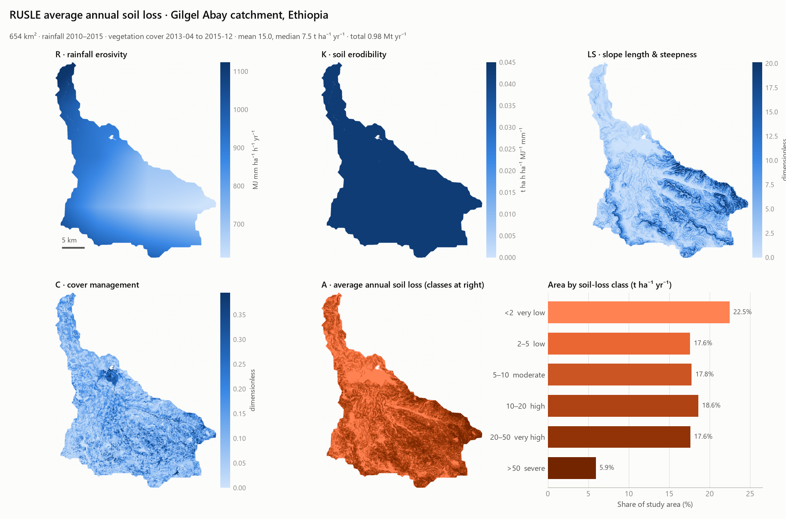
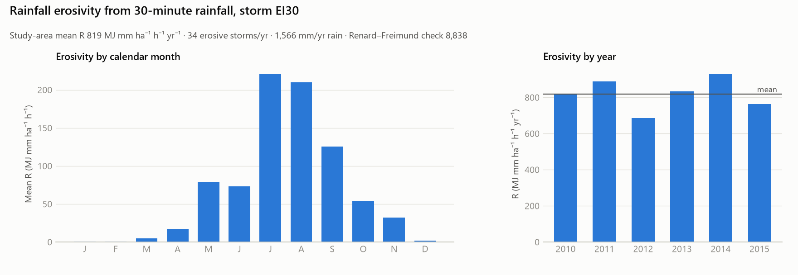

# RUSLE soil-loss pipeline: data guide

> **Historical (2026-11-14).** This describes the first, basin-scale soil-loss run (Gilgel Abay,
> 2010–2015, harness downloader). The current system takes a field polygon and dates, runs soil
> loss and landslide risk on US or global data, and is documented in [BACKEND.md](BACKEND.md).

What the soil-loss part of the project does, which data it uses, what it produces, and how to run
it. Exact file-format rules for producing inputs (tags, band order, export limits) are in
[INTEGRATION.md](INTEGRATION.md).

The pipeline computes **average annual soil loss** with RUSLE, `A = R · K · LS · C · P` (t ha⁻¹ yr⁻¹),
on a 30 m grid, plus farmer-oriented layers: when erosion happens, which conservation practice
would bring it under a tolerable level, and where runoff concentrates. It currently runs on the
Gilgel Abay headwaters in the Ethiopian Highlands (654 km², 2010–2015).



---

## 1. Quick start

```powershell
# once: Python 3.11 environment with the dependencies
py -3.11 -m venv C:\venvs\rusle          # any folder outside the repo
C:\venvs\rusle\Scripts\activate
pip install -r requirements.txt

# once: Earth Engine sign-in (opens a browser)
earthengine authenticate

# every session: the team's Earth Engine Cloud project
$env:EE_PROJECT = "spaceapps-514713"

# run from the repository root
python -m src.dataanal_harness.harness --synthetic   # offline test on fake data, about 1 min
python -m src.dataanal_harness.harness               # real data: download + pipeline, about 7 min the first time
python -m pytest                                     # unit + end-to-end tests
```

To use the `spaceapps-514713` project, your Google account must be a member of it. Ask the
project owner to add you in Google Cloud IAM with the **Service Usage Consumer** role and an
Earth Engine role such as **Earth Engine Resource Viewer**. Or register your own project at
<https://code.earthengine.google.com/register> (non-commercial) and set `EE_PROJECT` to it.

---

## 2. How the pieces fit together

```
 Earth Engine datasets ──► input GeoTIFFs ──► src/dataanal (pipeline) ──► output GeoTIFFs + summary.json + figures
                           data/<area>/inputs/                            outputs/<area>/
```

| Folder | What it is |
|---|---|
| `src/dataanal/` | **The pipeline.** GeoTIFFs in, GeoTIFFs out. No Earth Engine code; it runs on any files that follow the input format. |
| `src/dataanal_harness/` | **Earth Engine downloader + test harness.** Writes the input GeoTIFFs, prints a report on them, runs the pipeline, checks the results. Also makes synthetic inputs for offline testing. |
| `docs/INTEGRATION.md` | The exact input-file contract, for anyone producing inputs another way (e.g. `Export.image.toDrive`). |
| `data/<area>/` | Downloaded inputs and caches (not in git). |
| `outputs/<area>/` | Results. GeoTIFFs are not in git; `summary.json` and the figures are. |
| `tests/` | Formula tests and an end-to-end pipeline test. |

The pipeline can also be called without the harness, on any folder or list of GeoTIFFs:

```powershell
python -m src.dataanal.pipeline --out outputs\my_area data\my_area\inputs
```
```python
from src.dataanal.pipeline import run, Params
summary = run(["data/my_area/inputs"], "outputs/my_area", Params(label="My area"))
```

---

## 3. File format: GeoTIFF

All inputs and outputs are **GeoTIFFs**: ordinary TIFF images (`.tif`) that also store where the
pixels are on Earth (map projection, pixel position and size, no-data value). The pipeline needs
that information to line up layers that come on different grids. A plain TIFF without it is
rejected with an error. The outputs open directly in QGIS, ArcGIS or Earth Engine.

### Getting GeoTIFFs out of Earth Engine

Earth Engine can produce GeoTIFFs directly, in two ways:

| Route | How | Catch |
|---|---|---|
| `Export.image.toDrive` / `toCloudStorage` | Background task writes GeoTIFFs to Drive or Cloud Storage | Waits in a queue (minutes, sometimes longer); large exports are split into tiles |
| `getDownloadURL` / `computePixels` (GeoTIFF format) | Immediate download | About 48 MB per request; our `ndvi.tif` (72 MB) would need to be fetched in tiles |

Both routes allow **at most 5,000 bands per image** and **cannot write custom metadata tags**.
Rainfall needs both: six years of half-hourly data is about 105,000 time steps, and each rainfall
file needs time tags. So our harness asks Earth Engine for raw pixel arrays instead, stitches the
tiles, and writes the GeoTIFFs itself with all tags in place. If you export with
`Export.image.toDrive`, follow [INTEGRATION.md](INTEGRATION.md) §2.5: one file per month for
rainfall, then add the two time tags with a three-line Python snippet.

---

## 4. Input files

Location: `data/<area>/inputs/`. The pipeline recognises each file by its name (or a `RUSLE_ROLE` tag).

| File | What it is physically | Source and satellite | Earth Engine ID | Size* |
|---|---|---|---|---|
| `dem.tif` | Bare-ground elevation above sea level (m), with trees and buildings removed | **FABDEM**: the Copernicus GLO-30 DEM, measured by the **TanDEM-X / TerraSAR-X radar satellites** (DLR, 2011–2015), with forests and buildings removed by machine learning (Univ. of Bristol) | `projects/sat-io/open-datasets/FABDEM` | 5.3 MB |
| `soil_type.tif` | Dominant soil texture class of the root zone (1 coarse … 5 very fine, 6–7 organic). The whole study area is class 4, "fine" (35–60 % clay). | **ERA5-Land** (ECMWF / Copernicus). **Not satellite data:** the class comes from the FAO/UNESCO Digital Soil Map of the World, compiled from field soil surveys. | `ECMWF/ERA5_LAND/STATIC`, band `soil_type` | <0.1 MB |
| `ndvi.tif` (12 bands, Jan → Dec) | Vegetation greenness, (near-infrared − red)/(near-infrared + red). About 0.1 bare soil, 0.3–0.5 crops/grass, 0.7–0.9 dense forest. Median of each calendar month, Apr 2013 – Dec 2015. | **Landsat 8 OLI** (NASA/USGS), surface reflectance, 30 m: red band B4 and near-infrared B5. Clouds removed with the QA_PIXEL mask. 60 scenes; each pixel has 13–36 cloud-free views. | `LANDSAT/LC08/C02/T1_L2` (+ `LC09`, no data before 2021) | 72 MB |
| `water.tif` | Open water (lakes, reservoirs, wide rivers): 1 = water, excluded from the results | **Landsat 8 OLI**: green B3 and shortwave-infrared B6 (MNDWI index > 0) | as above | <0.1 MB |
| `aoi.tif` | The study area: one watershed (all land draining to one outlet), 1 = inside | **HydroBASINS** (WWF), derived from the **SRTM radar elevation mission** (Space Shuttle Endeavour, 2000) | `WWF/HydroSHEDS/v1/Basins/hybas_8` | <0.1 MB |
| `precip_2010.tif` … `precip_2015.tif` (17,520 bands each, one per half-hour) | Rain rate (mm/h) averaged over each ~11 km cell and half-hour | **NASA GPM IMERG V07 Final**: microwave rain estimates from a constellation of satellites, gaps filled with infrared from geostationary weather satellites, corrected monthly with rain gauges. Reference satellite: **TRMM** (NASA/JAXA) until 2014, then the **GPM Core Observatory**. | `NASA/GPM_L3/IMERG_V07`, band `precipitation` | about 1 MB each |

\* Sizes for the 654 km² Gilgel Abay run. The 30 m files are 1,233 × 1,477 px in UTM zone 37N; the
rainfall files are 6 × 7 px on IMERG's 0.1° grid.

These are written too, but are **not** pipeline inputs:
- `data/<area>/qa/landsat_clear_obs.tif`: cloud-free Landsat views per pixel.
- `data/<area>/qa/study_area.json`: the basin ID and the two grids.
- `data/<area>/imerg_cache/`: rainfall download chunks, used to resume.

---

## 5. Output files

Location: `outputs/<area>/`. Every raster is on the DEM's 30 m grid. Pixels outside the study area,
on water, or with missing inputs are no-data. Each file carries `DESCRIPTION` and `UNITS` metadata tags.

| File | What it represents physically | Units |
|---|---|---|
| `r_factor.tif` | **Rainfall erosivity**: how hard the rain hits the soil, i.e. storm energy × peak 30-minute intensity, summed over the year's storms, averaged 2010–2015 | MJ mm ha⁻¹ h⁻¹ yr⁻¹ |
| `k_factor.tif` | **Soil erodibility**: how easily the soil is detached and carried (soil loss per unit R on a standard bare test plot) | t ha h ha⁻¹ MJ⁻¹ mm⁻¹ |
| `ls_factor.tif` | **Slope length and steepness**: erosion relative to the standard plot (22 m long, 9 % slope) | – |
| `c_factor.tif` | **Cover**: erosion under the actual vegetation divided by erosion on bare tilled soil. 0 = fully protected, 1 = bare. Each month is weighted by how much erosive rain falls in it. | – |
| `p_factor.tif` | **Support practice** (terraces, contouring); 1 = none assumed | – |
| `slope.tif` | Terrain steepness | degrees |
| `soil_loss.tif` | **Average annual soil loss** from sheet and rill erosion. Gullies and soil re-deposited downslope are not included. | t ha⁻¹ yr⁻¹ |
| `soil_loss_class.tif` | Soil loss in 6 classes: 1 very low (<2), 2 low (2–5), 3 moderate (5–10), 4 high (10–20), 5 very high (20–50), 6 severe (>50) | class |
| `soil_loss_monthly.tif` (12 bands) | Soil loss in each calendar month; the bands add up to `soil_loss`. Shows when the soil most needs cover. | t ha⁻¹ month⁻¹ |
| `recommended_practice.tif` | Least effort that brings soil loss under the tolerance (11 t ha⁻¹ yr⁻¹): 0 no change, 1 contour farming, 2 strip cropping, 3 terraces or soil/stone bunds, 4 permanent vegetation (even terraces are not enough) | code |
| `soil_loss_with_practice.tif` | Soil loss if that practice is applied | t ha⁻¹ yr⁻¹ |
| `max_cover_factor.tif` | Highest C that keeps soil loss within tolerance. Where `c_factor` is higher, ground cover must improve. | – |
| `upslope_area.tif` | Area draining through each pixel: where runoff collects | ha |
| `stream_power_index.tif` | Erosive power of concentrated runoff: gully risk and natural waterways | m |
| `summary.json` | Area statistics, severity and practice breakdowns, monthly shares, rainfall checks, K table and K sensitivity | – |
| `rusle_maps.png`, `rainfall_erosivity.png` | Factor maps with soil-loss classes; erosivity by month and by year | – |

The class and code legends are also stored inside the files (`CLASS_*` / `CODE_*` tags).

---

## 6. Run times (measured, Gilgel Abay, 654 km²)

| Step | What happens | Time | Data |
|---|---|---|---|
| Elevation + soil type + basin mask | 9 tiles of 512 × 512 px | about 21 s (incl. Earth Engine setup) | 5.3 MB |
| Landsat NDVI + water | 30 tiles of 256 px × 15 bands; Earth Engine takes medians over 60 scenes for each tile | about 55 s | 72 MB |
| IMERG 2010–2015 | 222 requests of 10 days (480 half-hours each), 8 in parallel | about 2 min 20 s (about 23 s per year) | 6 MB |
| **Total download** | | **about 3.5 min** | **about 83 MB** |
| Pipeline | storm erosivity, water-flow routing over 1.8 million pixels, outputs, figures | about 3.7 min | 52 MB written |
| **End to end** | | **about 7 min** | |

Downloads are cached, so a re-run only repeats the pipeline step. Elevation and NDVI time grows
roughly with area. Rainfall time barely changes, because the area has only 42 IMERG pixels. Times
depend on Earth Engine's load.

---

## 7. First results (Gilgel Abay headwaters, 2010–2015)

| | |
|---|---|
| Mean soil loss | **15 t ha⁻¹ yr⁻¹** (median 7.5; 90th percentile 38) |
| Total | about 0.98 million t yr⁻¹ |
| Area above the 11 t ha⁻¹ yr⁻¹ tolerance | 40 % |
| With the recommended practices | mean 5.8 t ha⁻¹ yr⁻¹; 13 % of the area needs terraces or bunds, 4 % permanent vegetation |
| Timing | **April–June cause 48 % of the year's soil loss with only about 21 % of the erosive rain**: fields are bare at planting time |
| Rainfall | 1,566 mm yr⁻¹, 34 erosive storms yr⁻¹, R = 819 |



**Treat 15 t ha⁻¹ yr⁻¹ as a lower estimate.** Two factors are uncertain:

- **R is probably too low.** IMERG averages rain over ~11 km cells, which flattens storm peaks: the
  strongest half-hour in six years was 53 mm/h. A 2024 study across China found half-hourly IMERG
  erosivity about 55 % lower than gauge-based values. The annual-rain formula (Renard & Freimund)
  gives 8,838 here, but it was fitted to US data and likely overshoots. The true R is probably
  between the two, and soil loss scales directly with R. Calibrating against GloREDa (global
  gauge-based erosivity, Panagos et al. 2023) is the planned fix.
- **K has one class.** All of the basin is ERA5-Land class 4, so K is a single value (0.043). With
  the alternative Williams equation the mean soil loss would be 5.6 instead of 15.

---

## 8. Known limitations

- **Vegetation period:** Landsat 8 starts in April 2013 and Landsat 9 in 2021, so vegetation cover
  comes from 2013–2015 and is applied to all of 2010–2015.
- **No land-use input:** the practice map assumes the land is cultivated. Check it against what is
  actually grown.
- **P = 1:** existing terraces or bunds are not known, so soil loss is an upper bound in that respect.
- **Erosion types:** RUSLE covers sheet and rill erosion only, not gullies or landslides.
- **FABDEM licence:** CC BY-NC-SA 4.0, non-commercial use only. Credit: "FABDEM is produced
  using Copernicus WorldDEM-30 © DLR e.V."

---

## 9. Differences from the team design (root `README.md`)

The root README plans a broader tool (landslides + soil loss). For the soil-loss part, the
implementation differs in these places, mainly because the challenge limits sources to
ERA5-Land, Landsat 8/9 and IMERG:

| Item | Root README plan | Implemented here |
|---|---|---|
| R | Renard & Freimund from annual rain | Storm-by-storm EI30 from half-hourly IMERG. Renard & Freimund is computed as a cross-check; it gives 10× higher values here. |
| K | SoilGrids sand/silt/clay/SOC (250 m), Williams equation | ERA5-Land `soil_type` class → class texture → Römkens (AH703) equation; Williams reported as sensitivity |
| C | NASA HLS (Landsat + Sentinel-2), growing-season median | Landsat 8 monthly medians, weighted by monthly erosivity |
| LS | WhiteboxTools D-infinity catchment area, cap ~300 m | pysheds multiple-flow-direction accumulation, cap 300 m (same Moore & Burch formula) |
| Cropland mask | ESA WorldCover | none |
| Area | farmer's field polygon | any `aoi.tif` mask (currently a HydroBASINS watershed) |

For the landslide model: `slope.tif` (degrees) and `upslope_area.tif` (ha) are already produced on
the 30 m FABDEM grid. The specific catchment area *a* (m) in the root README equals
`upslope_area × 10,000 / 30` (upslope area divided by the 30 m cell width).

---

## 10. More detail

- [INTEGRATION.md](INTEGRATION.md): exact input-file rules (names, bands, no-data, grids, rainfall time tags, Earth Engine export limits).
- [src/dataanal/README.md](../src/dataanal/README.md): formulas and references for each factor.
- [src/dataanal_harness/README.md](../src/dataanal_harness/README.md): harness commands and Earth Engine dataset IDs.
